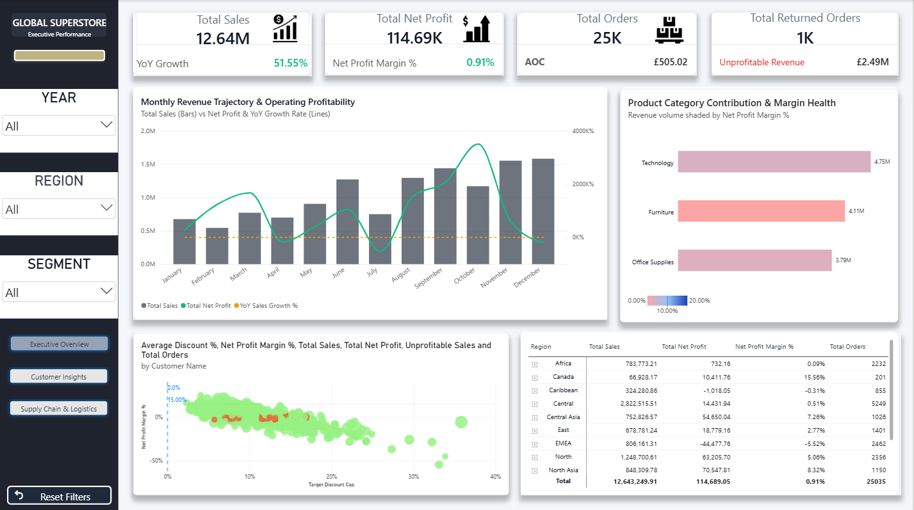
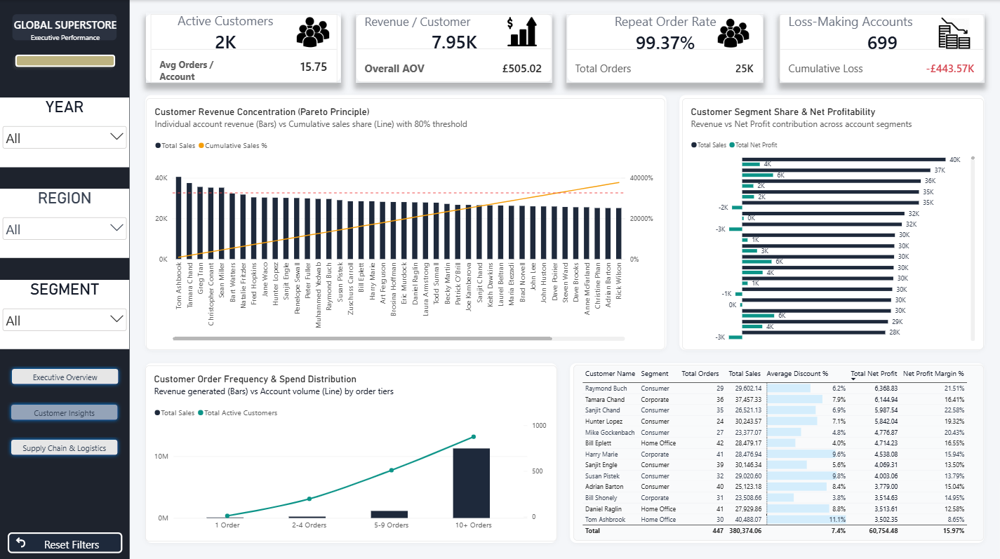
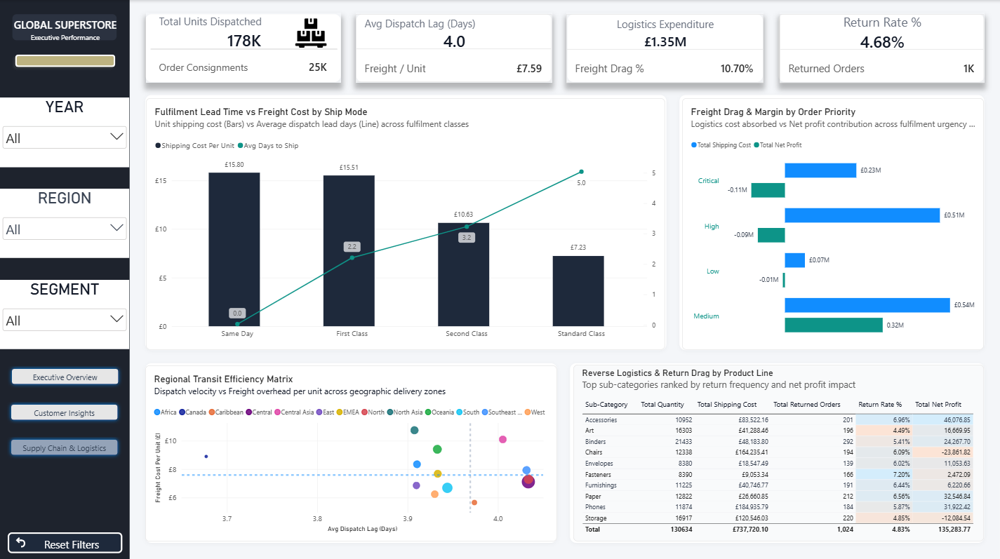

# Global Superstore Analysis — Power BI Dashboard

A three-page executive Power BI report for **Global Superstore**, a retailer selling across 13 regions worldwide from 2011 to 2014. It looks past headline sales to the question managers care about: *where does profit actually survive once shipping, discounts and returns are taken into account?*




---

## Headline numbers

| KPI | Value |
|---|---|
| Total Sales | **12.64M** |
| Profit before shipping | **1.47M (11.6% of sales)** |
| Shipping cost | **1.35M (10.7% of sales)** |
| Net Profit (profit after shipping) | **about 115K, a 0.91% margin** |
| Orders | **25,035** across **1,590** customer accounts |
| Average order value | **505** |
| Returned orders | **1,172 (4.68% of orders)** |
| Units dispatched | **178K**, with an average dispatch lag of **4.0 days** |

## Key insights

- **Shipping eats almost all of the profit.** The business earns 1.47M before freight, but shipping costs 1.35M, leaving a net margin of just 0.91%.
- **Sales grew every year, from 2.26M in 2011 to 4.30M in 2014.** Year-on-year growth was 18.5% in 2012, 27.2% in 2013 and 26.3% in 2014.
- **Furniture loses money once freight is counted.** It sells 4.11M but runs at a −3.8% net margin (about −155K). Technology (3.3%) and Office Supplies (3.0%) are the profitable lines.
- **Three regions are loss-making after shipping.** Southeast Asia (−76K), EMEA (−44K) and South (−28K) lose money, while North Asia (+71K), North (+63K) and Central Asia (+55K) lead. Central is the largest region by sales (2.82M) but earns only a 0.5% margin.
- **44% of customer accounts are unprofitable.** 699 of 1,590 accounts lose money after shipping, a combined loss of about 444K.
- **Customers come back.** 99.4% of accounts ordered more than once, averaging 16 orders per customer, so the problem is margin, not loyalty.
- **Faster shipping costs more.** Average dispatch lag is 2.2 days for First Class, 3.2 for Second Class and 5.0 for Standard Class, and Same Day and First Class carry the highest freight cost per unit.
- **Returns are a smaller issue than freight.** 4.68% of orders are returned.

## Report pages

| Page | What it shows |
|---|---|
| **Executive Overview** | Total Sales, Net Profit, Orders and Returned Orders with YoY growth and margin, a monthly revenue and profit trajectory, category contribution shaded by margin, a discount-vs-margin scatter by customer and a regional summary table |
| **Customer Insights** | Active customers, revenue per customer, repeat-order rate, loss-making accounts, a customer Pareto, segment share and profitability, order-frequency bands and a customer table |
| **Supply Chain and Logistics** | Units dispatched, dispatch lag, logistics expenditure, return rate, lead time vs freight cost by ship mode, freight drag by order priority, a regional transit matrix and a returns table by sub-category |

## Dashboard features

- **Year, Region and Segment slicers** that filter every page
- **Page navigation buttons** between the three pages, plus a **Reset Filters** button
- **KPI cards** with icons, YoY growth, margin and average order value
- **Combo charts** (bars and lines) for the monthly trend, ship mode and order frequency
- **Scatter charts** for discount vs profit margin by customer and for regional transit efficiency
- **Conditional colouring** on margin and return-rate columns in the tables
- Custom navy and gold theme with a sidebar layout and a background image

## What I did

1. **Modelled the data as a star schema:** one fact table (`Fact Orders Sales`) with `Dim Customers`, `Dim Products`, `Dim Regions` and a `Date Master` calendar table.
2. **Joined the Returns and People sheets** so returned orders and regional managers are available in the model.
3. **Built a Key Measures table** of DAX measures, including Total Sales, Total Net Profit, Net Profit Margin %, YoY Sales Growth %, Average Order Value, Repeat Customer Rate %, Return Rate %, Shipping Cost Per Unit, Avg Days to Ship, Cumulative Sales % and Unprofitable Customer Loss.
4. **Designed a three-page layout** with a shared slicer sidebar, navigation and reset buttons.
5. **Defined Net Profit as profit minus shipping cost**, so every page shows the true cost of delivery.

## Dataset

[`data/Global-Superstore.xlsx`](data/Global-Superstore.xlsx): the well-known Global Superstore sample dataset, a fictional retailer used for training. It contains no real customers or personal data.

| Sheet | Rows | Description |
|---|---|---|
| **Orders** | 51,290 | Order and ship dates, ship mode, customer, segment, location, market and region, product, category, sales, quantity, discount, profit, shipping cost and order priority (Jan 2011 – Dec 2014) |
| **Returns** | 1,173 | Returned order IDs by market |
| **People** | 13 | Regional manager for each region |

## Repository structure

```
├── report/
│   └── Global-Superstore-Analysis.pbix   # Dashboard
├── data/
│   └── Global-Superstore.xlsx            # Orders, Returns, People
├── assets/                               # Icons and background used in the report
└── images/                               # Dashboard screenshots
```

## More screenshots




## How to open

1. Install [Power BI Desktop](https://www.microsoft.com/power-platform/products/power-bi/desktop) (free).
2. Download `report/Global-Superstore-Analysis.pbix` and open it.
3. If you are asked for the data source, point it to `data/Global-Superstore.xlsx` and refresh.

---

Built by **Bukhtawar Ali** as part of the *AI-Powered Analytics with Power BI* course (EduHubSpot), 2026.
[LinkedIn](https://www.linkedin.com/in/bukhtawar-ali-4441291a9) · [Portfolio](https://bukhtawarali110.github.io) · [GitHub](https://github.com/BukhtawarAli110)
